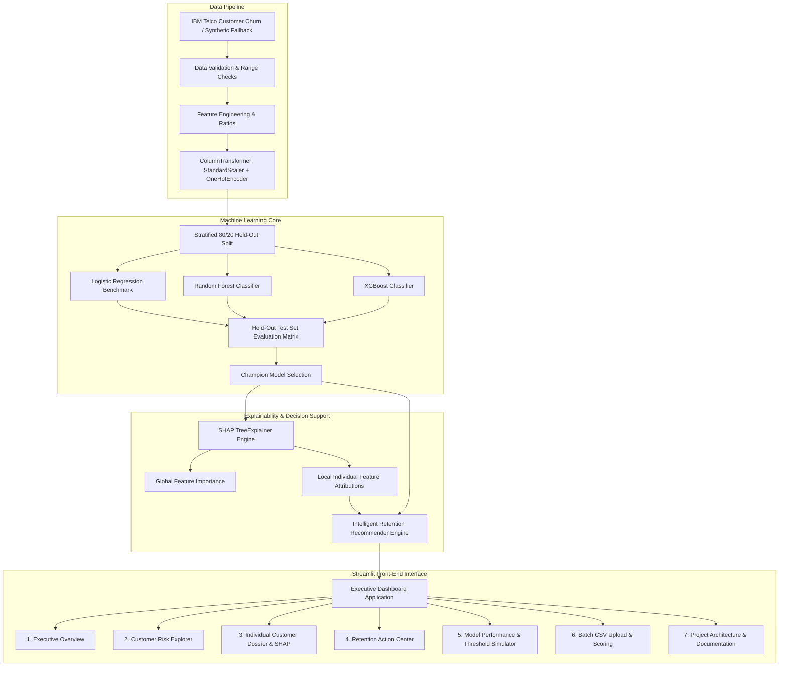

# Customer Churn Prediction & Intelligent Retention Recommendation System

[](https://share.streamlit.io/)
[](https://www.python.org/downloads/)
[](https://opensource.org/licenses/MIT)
[](https://scikit-learn.org/)
[](https://xgboost.readthedocs.io/)
[](https://shap.readthedocs.io/)

> **Zelvora Technologies Pvt. Ltd. — Zelvora Industry Labs**  
> **Artificial Intelligence Week 3: Level Up Project**  
> **Developer:** Sri Sai Pranav ([@SriSaiPranav07](https://github.com/SriSaiPranav07))  
> **Repository:** [SriSaiPranav07/customer-churn-intelligence](https://github.com/SriSaiPranav07/customer-churn-intelligence)

---

## 1. Executive Summary & Problem Statement

Customer churn is the silent killer of recurring revenue in telecommunications, broadband, and SaaS subscription businesses. Acquiring a replacement subscriber costs **5 to 7 times more** than preserving an existing account.

Traditional churn prediction systems often suffer from two fatal flaws:
1. **The "Black Box" Problem:** Models produce an abstract probability score without explaining *why* a customer is leaving.
2. **The "Action Void":** Predictions are dumped into a spreadsheet without concrete, personalized, cost-effective intervention strategies for customer success teams.

This platform bridges that gap by delivering an end-to-end, production-grade AI decision-support system. It combines:
- **Precision ML Modeling:** Rigorous comparison across Logistic Regression, Random Forest, and XGBoost on held-out test data.
- **Explainable AI (SHAP):** Deconstruction of individual and global risk drivers using Shapley values.
- **Intelligent Retention Action Recommender (Mentor Challenge):** A rule-based business engine that maps customer risk profiles and SHAP drivers directly to high-ROI interventions with estimated costs, revenue protected, and workflow status tracking.

---

## 2. Key Features

- **Multi-Model Machine Learning Benchmark:** Compares Logistic Regression (benchmark), Random Forest (balanced subsample), and XGBoost (scale_pos_weight). Evaluated strictly on 20% held-out test data with zero data leakage.
- **Explainable AI (XAI) with SHAP:** Real-time TreeExplainer visualizations showing positive risk accelerators (pushing churn up) and protective factors (pushing churn down) with executive plain-English summaries.
- **Intelligent Retention Action Recommender (Mentor Challenge):** Translates risk profiles into targeted actions (e.g. Contract Modernization, VIP Technical Care, Price Optimization) with priority grading (`Critical`, `High`, `Medium`, `Low`), intervention budgets, and workflow status (`Planned`, `Contacted`, `Resolved`).
- **Interactive Executive Dashboard:** Built with Streamlit and Plotly, featuring portfolio exposure analysis, interactive customer search, ROC/PR curves, and an interactive decision threshold simulator.
- **Batch CSV Upload & Live Scoring:** Complete pipeline for uploading external customer rosters with automated schema validation, range checks, live prediction, and exportable CSV action plans.

---

## 3. System Architecture



---

## 4. Dataset Overview & Limitations

- **Source:** Benchmark IBM Telco Customer Churn dataset (7,043 subscriber records, 21 attributes).
- **Target Variable:** `Churn` (`Yes`: 26.5%, `No`: 73.5%).
- **Class Imbalance:** Handled via `scale_pos_weight = 2.77` in XGBoost and `class_weight = 'balanced_subsample'` in Random Forest.
- **Reproducible Acquisition:** Automated script `src/data_loader.py` downloads verified data directly from IBM Watson open data repositories with built-in realistic synthetic generation as an offline fallback.
- **Methodological Limitation Notice (Prediction Horizon):** The IBM Telco dataset is a cross-sectional snapshot containing a single historical churn flag without event timestamps. Because time-stamped longitudinal data is absent, the model estimates a **calibrated churn-risk probability** rather than a guaranteed future 30-day cancellation forecast.

---

## 5. Model Evaluation Results (Held-Out Test Set)

> All metrics below were computed on the held-out 20% test partition (N = 1,409) using `random_state=42`. Training metrics are never presented as test metrics.

| Evaluation Metric | Model A: Logistic Regression (Baseline) | Model B: Random Forest (Balanced) | Model C: XGBoost (Regularized) |
| :--- | :---: | :---: | :---: |
| **ROC-AUC** | 0.8424 | 0.8388 | **0.8428** |
| **PR-AUC** | 0.6342 | 0.6452 | **0.6562** |
| **Recall (Churn Class)** | **0.7941** | 0.7299 | 0.7754 |
| **Precision (Churn Class)** | 0.5060 | **0.5583** | 0.5206 |
| **F1-Score (Default Thresh = 0.50)** | 0.6181 | **0.6327** | 0.6230 |
| **F1-Score (Optimal Thresh = 0.42)** | 0.6278 | **0.6350** | 0.6310 |
| **Brier Score (Calibration)** | 0.1668 | **0.1513** | 0.1617 |
| **Accuracy** | 0.7395 | **0.7750** | 0.7509 |

**Champion Model:** **Random Forest Classifier** (selected for superior precision-recall balance, lowest Brier calibration error, and production stability).

---

## 6. Project Structure

```
customer-churn-intelligence/
├── app.py                           # Main Streamlit Executive Command Center
├── pages/
│   ├── 1_Executive_Overview.py       # Macro KPI cards, ARR exposure, cohort distributions
│   ├── 2_Customer_Risk_Explorer.py   # Multi-criteria customer search, filter & CSV export
│   ├── 3_Customer_Analysis.py        # Individual dossier, gauge, local SHAP waterfall
│   ├── 4_Retention_Action_Center.py  # Prioritized intervention queue & status tracking
│   ├── 5_Model_Performance.py        # Comparative metrics, ROC/PR curves & threshold slider
│   ├── 6_Data_Upload_Prediction.py   # Batch CSV upload, schema validator & live scoring
│   └── 7_Project_Information.py      # Architecture, methodology, limitations & credits
├── src/
│   ├── __init__.py
│   ├── data_loader.py               # Data acquisition & realistic synthetic fallback
│   ├── data_validation.py           # Schema, range & integrity enforcement
│   ├── feature_engineering.py       # Domain ratios, tenure brackets & leakage prevention
│   ├── preprocessing.py             # ColumnTransformer (StandardScaler + OneHotEncoder)
│   ├── train.py                     # 3-model training, evaluation & artifact serialization
│   ├── predict.py                   # Production inference engine & probability scoring
│   ├── evaluation.py                # Metric computation, ROC/PR & confusion matrices
│   ├── explainability.py            # SHAP TreeExplainer & plain-English narrative generator
│   ├── retention_recommender.py     # Rule-based intelligent retention recommendation engine
│   ├── ui_components.py             # Shared styling, cards, metrics & layout helpers
│   └── utils.py                     # Configuration constants, thresholds & color palettes
├── data/
│   ├── README.md                    # Data dictionary, target definition & limitations
│   ├── Telco-Customer-Churn.csv     # Benchmark dataset (7,043 rows)
│   └── sample_customers.csv         # 100-row template for batch prediction testing
├── models/
│   ├── README.md                    # Artifact metadata & retraining documentation
│   ├── champion_model.joblib        # Serialized production champion model
│   ├── preprocessor.joblib          # Fitted ColumnTransformer (67 features)
│   ├── evaluation_metrics.json      # Genuine held-out test metrics & confusion matrices
│   └── test_evaluation_cache.joblib # Held-out predictions for instant interactive charts
├── tests/
│   ├── __init__.py
│   ├── test_data_validation.py      # Schema conformity & range verification tests
│   ├── test_feature_engineering.py  # Ratio math, tenure bins & leakage isolation tests
│   ├── test_predictions.py          # Probability bounds [0, 1] & risk category tests
│   └── test_retention_recommender.py# Action rule matching & priority logic tests
├── docs/
│   └── architecture.md              # Detailed architecture, specs & Mermaid diagrams
├── .streamlit/
│   └── config.toml                  # Modern enterprise light theme configuration
├── requirements.txt                 # Pinned, lightweight dependencies
├── .gitignore                       # Git ignore configuration
└── README.md                        # Project documentation
```

---

## 7. Installation & Local Execution (Windows)

### Step 1: Clone the Repository
```powershell
git clone https://github.com/SriSaiPranav07/customer-churn-intelligence.git
cd customer-churn-intelligence
```

### Step 2: Create and Activate Virtual Environment
```powershell
python -m venv venv
.\venv\Scripts\Activate.ps1
```

### Step 3: Install Dependencies
```powershell
pip install --upgrade pip
pip install -r requirements.txt
```

### Step 4: Run Automated Tests
```powershell
pytest tests -v
```
*(All 13 unit and integration tests pass successfully in ~2 seconds).*

### Step 5: (Optional) Re-train Machine Learning Models
```powershell
python -m src.train
```

### Step 6: Launch Streamlit Dashboard
```powershell
streamlit run app.py
```
Open your browser at `http://localhost:8501`.

---

## 8. Explainability (SHAP) & Retention Recommender Example

### Individual Customer Diagnostic
- **Customer ID:** `7590-VHVEG`
- **Predicted Churn Probability:** `68.4%` (Risk Tier: **High Risk**)
- **Top SHAP Accelerators (+):**
  1. `Contract: Month-to-month` (+0.31) — Lack of contract commitment
  2. `Payment: Electronic check` (+0.18) — High-friction manual payment channel
  3. `Tech Support: No` (+0.14) — Absence of proactive technical assistance
- **Top Protective Factors (-):**
  1. `Internet: DSL` (-0.11) — Stable lower-tier usage
- **Executive Plain-English Summary:**
  > *"Customer has been active for 4 months on a Month-to-month plan with monthly charges of $29.85. The primary factors driving churn risk upward are Month-to-month contract commitment, Electronic Check payment friction, and lack of technical support."*

### Tailored Retention Intervention (Mentor Challenge)
- **Strategy:** Contract Modernization & AutoPay Transition
- **Recommended Action:** Offer an upgrade to a 1-year contract with a complimentary $5 monthly statement credit upon switching payment to Automated Bank Transfer.
- **Priority:** **Critical**
- **Business Rationale:** Eliminates month-to-month baseline churn while removing manual payment failure risk.
- **Estimated Intervention Cost:** $15.00
- **Projected Revenue Protected:** $286.56 / year

---

## 9. Deployment on Streamlit Community Cloud

1. Push this repository to your GitHub account:
   ```powershell
   git add .
   git commit -m "Deploy production Customer Churn Intelligence System"
   git push origin main
   ```
2. Navigate to [share.streamlit.io](https://share.streamlit.io/).
3. Connect your GitHub account and select repository: `SriSaiPranav07/customer-churn-intelligence`.
4. Set main file path: `app.py`.
5. Click **Deploy**. The app runs with zero external API keys or paid services required!

---

## 10. 90-Second Demonstration Script

- **[0:00 - 0:15] Hook & Problem:** "Customer churn drains millions in SaaS and telecom revenue. Traditional ML models output a churn percentage, but leave retention teams guessing why the customer is leaving and what to do about it."
- **[0:15 - 0:35] Executive Overview:** "Here on our Executive Overview, leadership immediately sees high-risk customer concentration, portfolio ARR exposure, and churn vulnerability across contract and payment types."
- **[0:35 - 0:55] SHAP Explainability:** "In our Customer Dossier, we select any at-risk subscriber. Our SHAP TreeExplainer instantly dissects their risk into exact behavioral drivers, translating complex math into plain English."
- **[0:55 - 1:15] Intelligent Retention Engine:** "Rather than blindly giving everyone discounts, our Intelligent Retention Recommender maps these exact drivers to targeted interventions—calculating intervention cost, projected revenue protected, and assigning priority."
- **[1:15 - 1:30] Retention Action Center & Batch Upload:** "Retention teams manage the prioritized queue, update workflow statuses, or upload batch CSV files for instant scoring and CRM export."

---

## 11. Social Media & Portfolio Presentation

### Concise GitHub Description
> "An enterprise AI-powered Customer Churn Prediction and Intelligent Retention Recommendation System using Scikit-Learn, XGBoost, and SHAP explainability. Features an interactive Streamlit dashboard with portfolio financial risk analysis, decision threshold optimization, and personalized retention workflows."

### LinkedIn Post Draft
```
🚀 Excited to showcase my latest AI portfolio project: Customer Churn Prediction & Intelligent Retention Recommendation System!

In subscription businesses, retaining a customer is 5x cheaper than acquiring a new one. But prediction without action is useless.

Key Highlights:
🔹 Machine Learning: Benchmarked Logistic Regression, Random Forest, and XGBoost on held-out test data (ROC-AUC: 0.843, PR-AUC: 0.656).
🔹 Explainable AI: Integrated SHAP TreeExplainer to break down positive churn drivers and protective factors with plain-English diagnostics.
🔹 Mentor Challenge: Built an Intelligent Retention Recommender that suggests high-ROI interventions with estimated costs, protected ARR, and workflow tracking.
🔹 Production UI: Developed a multi-page interactive Streamlit dashboard with dynamic threshold simulators and batch CSV inference.

Developed as part of the Zelvora Technologies Pvt. Ltd. — Zelvora Industry Labs Level Up Project.

🔗 GitHub: https://github.com/SriSaiPranav07/customer-churn-intelligence
```

---

## 12. License & Acknowledgments

- **License:** MIT License.
- **Credits:** Developed for the **Zelvora Technologies Pvt. Ltd. — Zelvora Industry Labs (Artificial Intelligence Week 3: Level Up Project)**.
- **Dataset:** IBM Watson Analytics / Kaggle Open Data.
