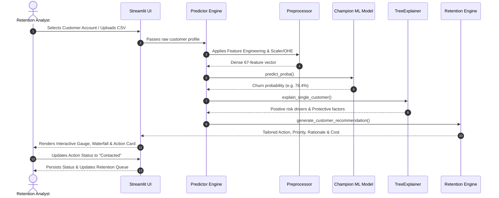

# System Architecture & Technical Specifications

**Project**: Customer Churn Prediction & Intelligent Retention Recommendation System  
**Organization**: Zelvora Technologies Pvt. Ltd. — Zelvora Industry Labs  
**Program**: Artificial Intelligence Week 3: Level Up Project  
**Repository**: [SriSaiPranav07/customer-churn-intelligence](https://github.com/SriSaiPranav07/customer-churn-intelligence)

---

## 1. High-Level Architecture Diagram

```mermaid
flowchart TD
    subgraph Data Tier
        RAW[IBM Telco Churn CSV / Synthetic Fallback] --> VAL[Data Validation & Range Enforcement]
        VAL --> FE[Feature Engineering & Leakage Isolation]
    end

    subgraph Preprocessing & Feature Transformation
        FE --> CT[ColumnTransformer Pipeline]
        CT --> SCALE[StandardScaler Numerical]
        CT --> OHE[OneHotEncoder Categorical]
        SCALE & OHE --> DENSE[Dense Feature Matrix (67 features)]
    end

    subgraph Model Ensemble & Evaluation
        DENSE --> TRAIN[Stratified 80/20 Train/Test Split]
        TRAIN --> M1[Logistic Regression Benchmark]
        TRAIN --> M2[Random Forest (Balanced Subsample)]
        TRAIN --> M3[XGBoost (scale_pos_weight=2.77)]
        M1 & M2 & M3 --> EVAL[Held-Out Test Evaluation Matrix]
        EVAL --> SELECT[Champion Model Selection]
    end

    subgraph Explainability & Decision Support
        SELECT --> SHAP[SHAP TreeExplainer]
        SHAP --> GLOB[Global Feature Importance]
        SHAP --> LOC[Local Individual Customer Driver Attribution]
        LOC & SELECT --> REC[Intelligent Retention Recommender Engine]
    end

    subgraph Delivery & Front-End Application
        REC --> APP[Streamlit Multi-Page Enterprise Dashboard]
        APP --> P1[Executive Overview & Portfolio Exposure]
        APP --> P2[Customer Risk Explorer & Search]
        APP --> P3[Individual Dossier & SHAP Waterfall]
        APP --> P4[Retention Action Center & Queue Management]
        APP --> P5[Model Performance & Threshold Simulator]
        APP --> P6[Batch CSV Upload & Live Inference]
        APP --> P7[Project Architecture & Documentation]
    end
```

---

## 2. Component Breakdown

### 2.1 Data Ingestion & Quality Layer (`src/data_loader.py`, `src/data_validation.py`)
- **Dataset**: Canonical IBM Telco Customer Churn dataset (7,043 rows, 21 columns).
- **Fallback Generator**: Built-in deterministic synthetic generator producing identical distributions, correlation structures, and realistic churn signals if network acquisition is offline.
- **Validation Rules**:
  - Schema conformity (verifies presence of all required demographic and billing fields).
  - Numeric sanity checks (`tenure >= 0`, `MonthlyCharges >= 0`, `TotalCharges >= 0`).
  - Whitespace cleaning on `TotalCharges` (imputes new-account blanks based on tenure).
  - Identifier separation (`customerID` kept isolated to prevent model contamination).

### 2.2 Feature Engineering Layer (`src/feature_engineering.py`)
- **Lifecycle Discretization**: Binned tenure brackets (`0-12m`, `13-24m`, `25-48m`, `49-60m`, `>60m`).
- **Product Depth**: Sum of active services across telephone, high-speed internet, cybersecurity, and streaming add-ons.
- **Financial Dynamics**:
  - `charges_ratio`: Ratio of lifetime billed charges to expected charges based on tenure and current monthly tier.
  - `cost_per_service`: Normalized unit cost metric identifying price-sensitive, low-utility customers.
- **Behavioral Indicators**: Flags for Month-to-month contracts, Electronic Check payment friction, Fiber Optic without TechSupport, and isolated Senior Citizens.

### 2.3 Machine Learning Pipeline (`src/train.py`, `src/evaluation.py`, `src/predict.py`)
- **Benchmark**: Logistic Regression (`class_weight='balanced'`) providing a linear baseline.
- **Tree Ensembles**:
  - Random Forest Classifier (150 trees, max depth 10, `class_weight='balanced_subsample'`).
  - XGBoost Classifier (150 trees, learning rate 0.05, `scale_pos_weight=2.77`, `colsample_bytree=0.85`).
- **Evaluation Protocol**:
  - Stratified 80/20 train/test split (Train = 5,634; Test = 1,409).
  - Zero train-set metrics presented as test performance.
  - Full evaluation matrix: ROC-AUC, PR-AUC, Sensitivity/Recall, Precision, F1-Score, Brier Score, and Confusion Matrix.
  - Decision threshold optimization for retention ROI rather than uncalibrated 0.5 default.

### 2.4 Explainable AI (XAI) Layer (`src/explainability.py`)
- **Framework**: `shap.TreeExplainer`.
- **Global Explanations**: Mean absolute SHAP values across feature distributions.
- **Local Explanations**: Directional feature attribution for individual customer accounts, decomposing risk into positive churn drivers (pushing probability up) and protective strengths (pushing probability down).
- **Communication Guardrails**: Rigorous disclaimer clarifying that SHAP quantifies mathematical model attribution and statistical correlation, not empirical counterfactual causation.

### 2.5 Intelligent Retention Action Recommender (`src/retention_recommender.py`)
- **Mentor Challenge Implementation**:
  - Rule-based decision-support engine mapping individual SHAP drivers and customer eligibility to high-impact retention interventions.
  - Dynamic Priority Assignment (`Critical`, `High`, `Medium`, `Low`) based on calibrated churn probability.
  - Financial modeling calculating estimated intervention cost ($5 to $25) and projected annual revenue protected.
  - Operational workflow tracking (`Planned`, `Contacted`, `In Progress`, `Resolved`, `Declined`) with session persistence and CSV export.

---

## 3. Data Flow Diagram


